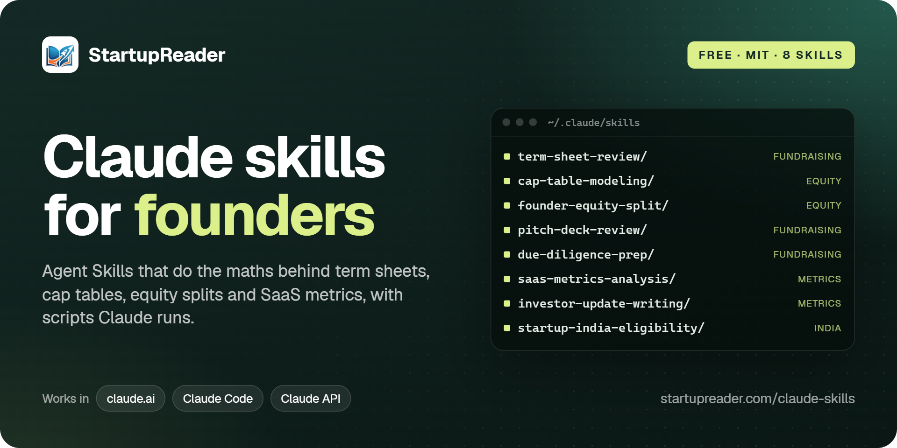
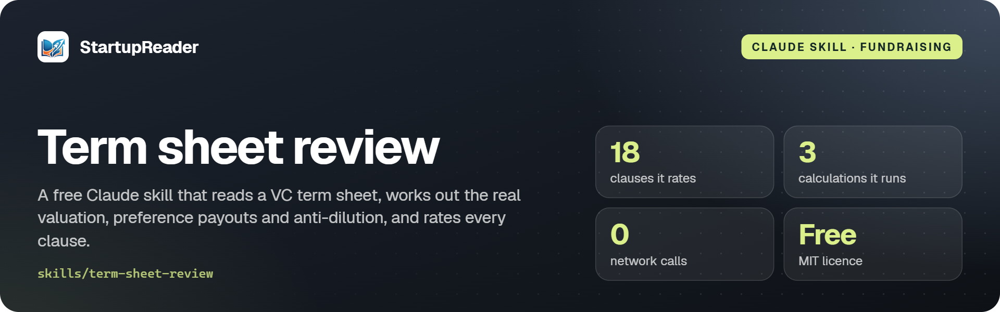
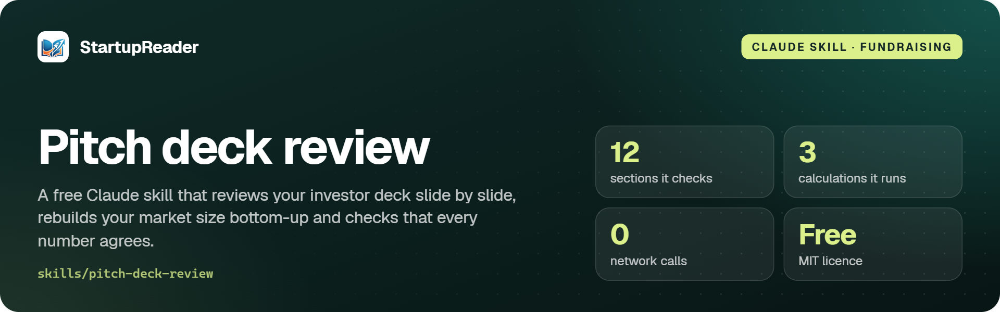
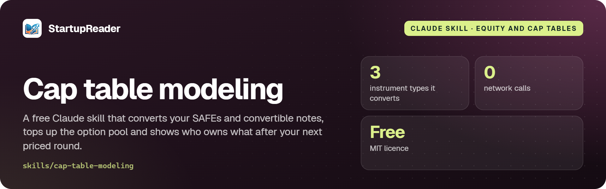
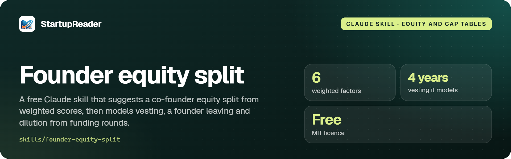
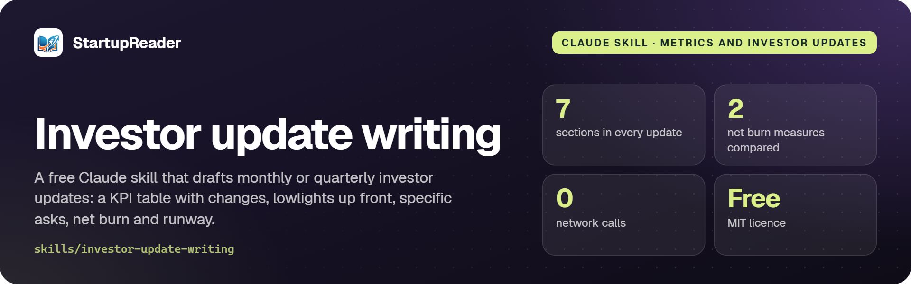

<!-- Generated by startup-hub/scripts/skills-repo/build.ts from the skills on startupreader.com. Edit there, not here. -->
<p align="center">
  <a href="https://startupreader.com/claude-skills"></a>
</p>

<p align="center">
  <a href="https://startupreader.com/claude-skills"></a>
  <a href="https://github.com/startupreader/claude-skills/releases/latest"></a>
  <a href="#the-skills"></a>
  <a href="LICENSE"></a>
  <a href="https://agentskills.io/specification"></a>
</p>

<p align="center">
  <b>Free skills that make Claude do a founder's numbers properly.</b><br>
  Review a term sheet, model a cap table, split equity, check a pitch deck, get ready for due diligence,<br>
  compute SaaS metrics, write an investor update or check Startup India eligibility.
</p>

<p align="center">
  <a href="#install">Install</a> ·
  <a href="#the-skills">The skills</a> ·
  <a href="https://github.com/startupreader/claude-skills/releases/latest">Download ZIPs</a> ·
  <a href="https://startupreader.com/claude-skills">Guides and worked examples</a> ·
  <a href="https://startupreader.com">startupreader.com</a>
</p>

---

Each folder in [`skills/`](skills) is an [Agent Skill](https://platform.claude.com/docs/en/agents-and-tools/agent-skills/overview): a `SKILL.md` that tells Claude how to do one job, plus the scripts and reference notes it needs. Claude reads a skill's description, uses the skill when your request matches it, and runs the scripts for the arithmetic, so the valuation, dilution and churn figures come from code, not from guesswork.

They work in **claude.ai** and the Claude apps, in **Claude Code**, and through the **Claude API**. Every page on [startupreader.com/claude-skills](https://startupreader.com/claude-skills) has a worked example with the scripts' real output, an FAQ and the limits of each skill.

## The skills

| Skill | What it's for | Get it |
| --- | --- | --- |
| **[Term sheet review](#term-sheet-review)** | Reads a VC term sheet, works out the real valuation, preference payouts and anti-dilution, and rates every clause. | [Guide](https://startupreader.com/claude-skills/term-sheet-review) · [ZIP](https://github.com/startupreader/claude-skills/releases/latest/download/term-sheet-review.zip) |
| **[Cap table modeling](#cap-table-modeling)** | Converts your SAFEs and convertible notes, tops up the option pool and shows who owns what after your next priced round. | [Guide](https://startupreader.com/claude-skills/cap-table-modeling) · [ZIP](https://github.com/startupreader/claude-skills/releases/latest/download/cap-table-modeling.zip) |
| **[Founder equity split](#founder-equity-split)** | Suggests a co-founder equity split from weighted scores, then models vesting, a founder leaving and dilution from funding rounds. | [Guide](https://startupreader.com/claude-skills/founder-equity-split) · [ZIP](https://github.com/startupreader/claude-skills/releases/latest/download/founder-equity-split.zip) |
| **[Pitch deck review](#pitch-deck-review)** | Reviews your investor deck slide by slide, rebuilds your market size bottom-up and checks that every number agrees. | [Guide](https://startupreader.com/claude-skills/pitch-deck-review) · [ZIP](https://github.com/startupreader/claude-skills/releases/latest/download/pitch-deck-review.zip) |
| **[Due diligence prep](#due-diligence-prep)** | Builds your data room index from file names, maps your documents to a due diligence checklist and flags the gaps and red flags. | [Guide](https://startupreader.com/claude-skills/due-diligence-prep) · [ZIP](https://github.com/startupreader/claude-skills/releases/latest/download/due-diligence-prep.zip) |
| **[SaaS metrics analysis](#saas-metrics-analysis)** | Turns an MRR export into the monthly MRR bridge, churn, NRR, GRR and ARPA, then LTV:CAC, CAC payback, runway and burn multiple. | [Guide](https://startupreader.com/claude-skills/saas-metrics-analysis) · [ZIP](https://github.com/startupreader/claude-skills/releases/latest/download/saas-metrics-analysis.zip) |
| **[Investor update writing](#investor-update-writing)** | Drafts monthly or quarterly investor updates: a KPI table with changes, lowlights up front, specific asks, net burn and runway. | [Guide](https://startupreader.com/claude-skills/investor-update-writing) · [ZIP](https://github.com/startupreader/claude-skills/releases/latest/download/investor-update-writing.zip) |
| **[Startup India eligibility](#startup-india-eligibility)** | Checks DPIIT recognition, the 80-IAC tax holiday, ESOP tax deferral and Startup India schemes from your company's dates and turnover. | [Guide](https://startupreader.com/claude-skills/startup-india-eligibility) · [ZIP](https://github.com/startupreader/claude-skills/releases/latest/download/startup-india-eligibility.zip) |

## Install

### claude.ai and the Claude apps

1. Download a skill's ZIP from the [latest release](https://github.com/startupreader/claude-skills/releases/latest) or its page on [startupreader.com](https://startupreader.com/claude-skills). Keep it zipped.
2. In Claude, open **Settings > Capabilities** and turn on **Code execution and file creation**.
3. Open **Customize > Skills**, click **+**, choose **Create skill**, then **Upload a skill**, and pick the ZIP.

Leave the skill switched on. Claude uses it when your request matches; you don't have to name it. On Team and Enterprise plans an owner turns on skills first. See Anthropic's [help centre](https://support.claude.com/en/articles/12512180-use-skills-in-claude).

### Claude Code

Add this repo as a plugin marketplace and install all 8 skills:

```text
/plugin marketplace add startupreader/claude-skills
/plugin install founder-skills@startupreader
```

Or copy the folders you want into your personal skills folder (or `.claude/skills/` in a repository to share them with your team):

```bash
git clone https://github.com/startupreader/claude-skills.git
mkdir -p ~/.claude/skills
cp -r claude-skills/skills/term-sheet-review ~/.claude/skills/
```

The scripts need Python 3. See the [Claude Code skills docs](https://code.claude.com/docs/en/skills).

### Claude API

Upload a skill folder once; the response includes its id:

```bash
cd skills
curl -X POST "https://api.anthropic.com/v1/skills" \
  -H "x-api-key: $ANTHROPIC_API_KEY" \
  -H "anthropic-version: 2026-10-21" \
  -F "files[]=@term-sheet-review/SKILL.md;filename=term-sheet-review/SKILL.md" \
  -F "files[]=@term-sheet-review/references/clauses.md;filename=term-sheet-review/references/clauses.md" \
  -F "files[]=@term-sheet-review/scripts/term_sheet_math.py;filename=term-sheet-review/scripts/term_sheet_math.py"
```

Then list the id in a request's `container`, with the code execution tool that skills run in:

```bash
curl https://api.anthropic.com/v1/messages \
  -H "x-api-key: $ANTHROPIC_API_KEY" \
  -H "anthropic-version: 2026-10-21" \
  -H "content-type: application/json" \
  -d '{
    "model": "claude-opus-5-5",
    "max_tokens": 4096,
    "container": {
      "skills": [{ "type": "custom", "skill_id": "YOUR_SKILL_ID", "version": "latest" }]
    },
    "tools": [{ "type": "code_execution_20250825", "name": "code_execution" }],
    "messages": [{ "role": "user", "content": "Here is our term sheet. What is the real pre-money valuation?" }]
  }'
```

Skills on the API run without network access, which is why these scripts use only Python's standard library. See Anthropic's [skills API guide](https://platform.claude.com/docs/en/build-with-claude/skills-guide) for the request format.

## Fundraising

Term sheets, pitch decks and due diligence.

### Term sheet review

<a href="https://startupreader.com/claude-skills/term-sheet-review"></a>

Upload a term sheet and Claude turns it into numbers: the effective pre-money after the option pool, what the liquidation preference pays at different exits, and what anti-dilution does in a down round. Then it rates each clause as founder-friendly, market standard or aggressive, and drafts the questions for your lawyer.

**Ask Claude things like**

- *"Here's our Series A term sheet. What's the real valuation?"*
- *"Is a 1x participating preference capped at 3x normal for a seed round?"*
- *"Review this LOI and tell me what to push back on."*

**What it does**

- Extracts every term into one table, with section numbers, and marks what the document leaves out.
- Works out the price per share and effective pre-money once the option pool is counted, and shows who pays for the pool.
- Shows what the investor and everyone else receive at a low, middle and high exit under the liquidation preference.
- Models a down round at half the price to show what the anti-dilution clause would cost founders.
- Rates each clause as founder-friendly, market standard or aggressive, with the reason, and lists what to negotiate first with a fallback.
- Writes numbered questions for your lawyer that are specific to this document.

**What's in the folder** ([`skills/term-sheet-review`](skills/term-sheet-review))

- [`SKILL.md`](skills/term-sheet-review/SKILL.md): the instructions Claude reads when your request matches
- [`references/clauses.md`](skills/term-sheet-review/references/clauses.md): reference Claude opens only when it needs it
- [`scripts/term_sheet_math.py`](skills/term-sheet-review/scripts/term_sheet_math.py): Python 3, standard library only, no network

<details>
<summary><b>See it run</b> (the script's real output)</summary>

Acme Logs, a made-up developer-tools startup, has a Series A offer: $5M at a $20M pre-money valuation, a 10% post-money option pool created before the round, a 1x participating preference capped at 3x, and broad-based weighted average anti-dilution. The founders hold 7,000,000 shares and there is no pool yet.

```console
$ python scripts/term_sheet_math.py pool --pre 20000000 --raise 5000000 --pool-post 0.10 --existing 7000000
Option pool shuffle (pool created before the round, inside the pre-money)
  Post-money valuation:      25,000,000
  Price per share:           2.5000
  New investor shares:       2,000,000  (20.0%)
  Pool shares added:         1,000,000
  Pool after round:          1,000,000  (10.0%)
  Existing holders after:    7,000,000  (70.0%)
  Effective pre-money:       17,500,000  (headline 20,000,000)
  Cost of the pool to existing holders: 2,500,000
  Same pool created after the round instead: existing holders 72.0%, investor 18.0%
```

The [full worked example](https://startupreader.com/claude-skills/term-sheet-review#example) shows what Claude writes from it.

</details>

**[Read the guide](https://startupreader.com/claude-skills/term-sheet-review)** · **[Download term-sheet-review.zip](https://github.com/startupreader/claude-skills/releases/latest/download/term-sheet-review.zip)** · Learn the basics: [Term sheet explained](https://startupreader.com/learn/term-sheet-explained), [Pre-money vs post-money valuation](https://startupreader.com/learn/pre-money-vs-post-money-valuation), [Liquidation preference explained](https://startupreader.com/learn/liquidation-preference), [Anti-dilution protection](https://startupreader.com/learn/anti-dilution-protection), [Pro-rata rights explained](https://startupreader.com/learn/pro-rata-rights), [Drag-along and tag-along rights explained](https://startupreader.com/learn/drag-along-tag-along-rights) · Check the maths by hand: [Dilution calculator](https://startupreader.com/tools/dilution-calculator), [SAFE conversion calculator](https://startupreader.com/tools/safe-conversion-calculator)

### Pitch deck review

<a href="https://startupreader.com/claude-skills/pitch-deck-review"></a>

Share your pitch deck and Claude reads it the way an investor would: slide by slide, against the twelve sections most decks need. It rebuilds your TAM, SAM and SOM from customer counts and prices, checks growth claims, runway and use of funds with a bundled script, and returns a scorecard, the five fixes that matter most and the questions investors are likely to ask.

**Ask Claude things like**

- *"Review my seed deck before I send it to investors."*
- *"Is our TAM slide credible? We quote one big industry figure."*
- *"Here's our pre-seed deck. What's missing?"*

**What it does**

- Maps every slide to a standard structure, from problem and why now to the ask and use of funds, and lists the sections the deck leaves out.
- Rebuilds TAM, SAM and SOM bottom-up from your customer counts and prices, and compares them with the figures on the market slide.
- Builds a ledger of every number in the deck and flags figures that disagree between slides or lack a definition, period or date.
- Recomputes growth claims, runway from the raise and the burn plan, the use of funds total and the stake sold, with a small bundled script.
- Rates each slide Strong, Needs work, Weak or Missing against what investors look for at your stage.
- Lists the five fixes that matter most, the superlatives to back up or cut, and the questions investors are likely to ask.

**What's in the folder** ([`skills/pitch-deck-review`](skills/pitch-deck-review))

- [`SKILL.md`](skills/pitch-deck-review/SKILL.md): the instructions Claude reads when your request matches
- [`references/slide-checklist.md`](skills/pitch-deck-review/references/slide-checklist.md): reference Claude opens only when it needs it
- [`scripts/market_size.py`](skills/pitch-deck-review/scripts/market_size.py): Python 3, standard library only, no network

<details>
<summary><b>See it run</b> (the script's real output)</summary>

Molarly, a made-up clinic software startup, is raising a $1.5M seed round at a $6M pre-money valuation. Its deck quotes a top-down $4.2B TAM, says MRR grew from $8,000 to $30,000 over nine months with "40% month-on-month growth", plans $2.4M of revenue in year three, and promises 24 months of runway. It has $100,000 in the bank and plans to burn $60,000 a month for six months, then $85,000 once it hires. Its own research counts 40,000 independent clinics paying $1,200 a year, half of them reachable today, and 6,000 group practices paying $4,800, a quarter reachable, and it assumes it can win 3% of what it can reach. There is no why-now or competition slide. All figures are invented.

```console
$ python scripts/market_size.py market --segment "Independent clinics" 40000 1200 50% --segment "Group practices" 6000 4800 25% --som-share 3% --claimed-tam 4200000000 --revenue-target 2400000
Bottom-up market size (annual revenue; price per customer per year)
  Segment                Customers   Price/yr             TAM   Reach             SAM
  Independent clinics       40,000      1,200      48,000,000     50%      24,000,000
  Group practices            6,000      4,800      28,800,000     25%       7,200,000
  TAM  every customer in every segment       76,800,000  (46,000 customers)
  SAM  the part the product can reach        31,200,000  (21,500 customers)
  SOM  3.0% of SAM                              936,000  (645 customers)
  Deck's TAM 4,200,000,000 is 54.7x the bottom-up TAM.
  Revenue target 2,400,000: 7.7% of SAM, 2.56x the SOM.
  At the average serviceable price (1,451) that is 1,654 customers.
```

The [full worked example](https://startupreader.com/claude-skills/pitch-deck-review#example) shows what Claude writes from it.

</details>

**[Read the guide](https://startupreader.com/claude-skills/pitch-deck-review)** · **[Download pitch-deck-review.zip](https://github.com/startupreader/claude-skills/releases/latest/download/pitch-deck-review.zip)** · Learn the basics: [Startup funding stages](https://startupreader.com/learn/startup-funding-stages), [What is pre-seed funding?](https://startupreader.com/learn/what-is-pre-seed-funding), [How to value a pre-revenue startup](https://startupreader.com/learn/how-to-value-a-pre-revenue-startup), [Unit economics and the LTV:CAC ratio](https://startupreader.com/learn/unit-economics-ltv-cac), [ARR vs MRR](https://startupreader.com/learn/arr-vs-mrr) · Check the maths by hand: [Burn rate and runway calculator for startups](https://startupreader.com/tools/burn-rate-runway-calculator), [CAGR calculator](https://startupreader.com/tools/cagr-calculator), [LTV and CAC calculator](https://startupreader.com/tools/ltv-cac-calculator)

### Due diligence prep

<a href="https://startupreader.com/claude-skills/due-diligence-prep"></a>

Point Claude at your shared drive, or paste a list of file names, and it builds a data room index for a seed or Series A round: what you have, what is missing and what applies only in some cases. Then it looks for the red flags investors' lawyers find, such as unsigned IP assignments, missing approvals and late filings, and for Indian companies it adds the ROC and FEMA items with their deadlines.

**Ask Claude things like**

- *"We just signed a term sheet. What will the investor's lawyers ask for?"*
- *"Here's a list of everything in our shared drive. Turn it into a data room."*
- *"One of our angels is based abroad. Which FEMA filings should we have?"*

**What it does**

- Builds a data room index for a seed or Series A round, in folders from corporate records to litigation and disclosures.
- Maps your existing files to it by name, without opening them, and suggests which folder each one belongs in.
- Lists what is missing, and what to confirm because it applies only to some companies, such as a POSH committee or Form CN.
- Flags file names that look like drafts, unsigned copies, templates or duplicate downloads.
- Checks for the red flags that slow rounds: a cap table that doesn't match the share register or allotment filings, IP not assigned to the company, missing approvals, contractors without IP clauses and unfiled forms.
- For Indian companies, adds statutory registers, ROC filings, demat, valuation reports for share issues and FEMA reporting for foreign investment.
- Drafts questions for the founders and a disclosure list of known issues.

**What's in the folder** ([`skills/due-diligence-prep`](skills/due-diligence-prep))

- [`SKILL.md`](skills/due-diligence-prep/SKILL.md): the instructions Claude reads when your request matches
- [`assets/example-files.txt`](skills/due-diligence-prep/assets/example-files.txt): example input to try it on
- [`references/checklist.md`](skills/due-diligence-prep/references/checklist.md): reference Claude opens only when it needs it
- [`scripts/data_room_index.py`](skills/due-diligence-prep/scripts/data_room_index.py): Python 3, standard library only, no network

<details>
<summary><b>See it run</b> (the script's real output)</summary>

Tealbrook Labs, a made-up Indian software startup with 8 employees, is preparing for a seed round. It raised an angel round in 2024, including money from an angel based outside India. The founders paste the 26 file names in their shared drive, from the certificate of incorporation to a draft pitch deck.

```console
$ python scripts/data_room_index.py --list assets/example-files.txt --india --fema --show table
Data room check: 26 file names from assets/example-files.txt (names only; no file was opened)
Checklist: core + India + FEMA, 39 items, 22 with a matching file
  Section                                     Found  Missing  Check
  01 Corporate records                            7        1      1
  02 Cap table and ESOP                           4        3      0
  03 Finance                                      3        0      0
  04 Tax                                          2        1      1
  05 Intellectual property                        3        0      0
  06 Contracts                                    1        1      0
  07 People                                       1        1      1
  08 FEMA (foreign investment)                    1        3      1
  09 Regulatory, litigation and disclosures       0        1      2
Missing
  01  Statutory registers (register of members and others)
  02  Share certificates
  02  Offer letter for every private placement
  02  Option grant letters and vesting records
  04  Income tax returns, assessments and notices
  06  Key supplier and partner contracts
  07  Privacy policy and personal data handling
  08  Fair value certificate for every foreign issue
  08  Annual FLA returns
  08  Beneficial ownership check (land-border rules)
  09  Disclosure list of known issues
Check: needed only in some cases
  01  Demat records for the company's shares: most private companies other than small companies
  04  Provident fund and ESI registrations and payments: where they apply to the company
  07  POSH Act internal committee: if the company has 10 or more employees
  08  FC-TRS, Form CN, Form DI: only for transfers with non-residents, convertible notes or downstream investment
  09  Sector licences: if the business needs any
  09  Litigation, disputes and regulatory notices: if there are any
Names to check (keep only final, signed versions)
  Fundraising/Cap table v7.xlsx: version number: confirm it is the final one
  People/Employment agreement template.docx: template, not a signed document
  IP/IP assignment - Founder B (unsigned).pdf: unsigned
  Misc/Pitch deck v12 draft.pdf: draft; version number: confirm it is the final one
Not matched to any item (place by hand)
  Misc/Pitch deck v12 draft.pdf
```

The [full worked example](https://startupreader.com/claude-skills/due-diligence-prep#example) shows what Claude writes from it.

</details>

**[Read the guide](https://startupreader.com/claude-skills/due-diligence-prep)** · **[Download due-diligence-prep.zip](https://github.com/startupreader/claude-skills/releases/latest/download/due-diligence-prep.zip)** · Learn the basics: [Startup due diligence checklist](https://startupreader.com/learn/startup-due-diligence-checklist), [Cap table explained](https://startupreader.com/learn/cap-table-explained), [Term sheet explained](https://startupreader.com/learn/term-sheet-explained), [Foreign investment in Indian startups](https://startupreader.com/learn/fdi-in-indian-startups), [CCPS vs CCD](https://startupreader.com/learn/ccps-vs-ccd), [409A valuation explained](https://startupreader.com/learn/409a-valuation-and-fmv-india)

## Equity and cap tables

Splits, vesting, SAFEs and dilution.

### Cap table modeling

<a href="https://startupreader.com/claude-skills/cap-table-modeling"></a>

Give Claude your cap table, your SAFEs and convertible notes and the round you expect, and it builds the cap table after the round: what each SAFE and note converts into, the option pool top-up, the price per share, and every holder's shares and fully diluted percentage before and after. It also shows the effective pre-money: how much of the headline valuation your existing shares are actually priced at.

**Ask Claude things like**

- *"Here's our cap table and our SAFEs. What do we each own after a $4M seed at $16M pre?"*
- *"Does our angel SAFE convert at the cap or the discount if the round is priced at $10M?"*
- *"How much is the 10% option pool really costing the founders?"*

**What it does**

- Converts post-money SAFEs, pre-money SAFEs and convertible notes at the lowest of the cap price, the discount price and the round price, and says which one applied.
- Adds a convertible note's simple interest to the amount that converts, and flags a note that is past its maturity date.
- Tops up the option pool to the investors' post-money target, counting any unallocated pool you already have.
- Works out the round's price per share and issues the new investors' shares.
- Shows every holder's shares and fully diluted percentage before and after, plus the founders' and the SAFE and note holders' combined stakes.
- Splits the headline pre-money into what your existing shares are priced at, what the pool takes and what the conversions take.
- Flags MFN clauses where a later SAFE or note got better terms, and reruns what-ifs: a different valuation, a smaller pool, or conversions outside the pre-money.

**What's in the folder** ([`skills/cap-table-modeling`](skills/cap-table-modeling))

- [`SKILL.md`](skills/cap-table-modeling/SKILL.md): the instructions Claude reads when your request matches
- [`assets/example-cap-table.json`](skills/cap-table-modeling/assets/example-cap-table.json): example input to try it on
- [`references/conversion-rules.md`](skills/cap-table-modeling/references/conversion-rules.md): reference Claude opens only when it needs it
- [`scripts/cap_table.py`](skills/cap-table-modeling/scripts/cap_table.py): Python 3, standard library only, no network

<details>
<summary><b>See it run</b> (the script's real output)</summary>

Fernhollow Labs, a made-up climate-software startup, is raising a $4M seed at a $16M pre-money with a 10% post-money option pool. Its founders, Asha and Leo, hold 4,500,000 shares each; employees hold 400,000 granted options and 600,000 more sit unallocated in the pool. Earlier it raised an uncapped $100,000 advisor SAFE with an MFN clause, $750,000 of post-money SAFEs at a $7.5M cap, a $150,000 pre-money SAFE at a $6M cap from an accelerator, and a $500,000 bridge note at 8% simple interest with an $8M cap and a 20% discount, issued a year before the round closes.

```console
$ python scripts/cap_table.py assets/example-cap-table.json
Cap table model: Fernhollow Labs (fictional), Seed (amounts in USD)
Round: 4,000,000 new money at a 16,000,000 pre-money (20,000,000 post-money)
Unallocated pool target after the round: 10.0% of the fully diluted company

Conversions (each converts at the lowest of its cap price, discount price and the round price)
  Instrument        Type               Converting  Cap price  Disc. price  Converts at       Shares
  Advisor SAFE      post-money SAFE       100,000          -            -  round price       83,877
  Angel SAFEs       post-money SAFE       750,000     0.6076            -  cap            1,234,283
  Accelerator SAFE  pre-money SAFE        150,000     0.5416            -  cap              276,938
  Bridge note       convertible note      540,000     0.7222       0.9538  cap              747,734
  Bridge note: 500,000 principal + 40,000 simple interest (8.0% a year for 1.00 years)

Round price per share: 1.1922  (16,000,000 pre-money / 13,420,382 pre-money fully diluted shares)

  Holder            Shares before  % before   Shares after   % after
  Asha (founder)        4,500,000    45.00%      4,500,000    26.82%
  Leo (founder)         4,500,000    45.00%      4,500,000    26.82%
  Granted options         400,000     4.00%        400,000     2.38%
  Unallocated pool        600,000     6.00%      1,677,548    10.00%
  Advisor SAFE                  -         -         83,877     0.50%
  Angel SAFEs                   -         -      1,234,283     7.36%
  Accelerator SAFE              -         -        276,938     1.65%
  Bridge note                   -         -        747,734     4.46%
  Seed investors                -         -      3,355,095    20.00%
  Total                10,000,000   100.00%     16,775,475   100.00%
Founders together: 9,000,000 shares, 90.00% before, 53.65% after
SAFEs and notes together: 2,342,832 shares, 13.97% after

Effective pre-money for today's holders: 11,922,165  (headline 16,000,000)
  Headline 16,000,000 = today's holders 11,922,165 + pool top-up 1,284,670 + SAFE and note conversions 2,793,165
Post-money at the round price: 20,000,000

Notes
  - Advisor SAFE has an MFN clause, and later instruments have better terms: Angel SAFEs (cap 7,500,000, post-money SAFE), Accelerator SAFE (cap 6,000,000, pre-money SAFE), Bridge note (cap 8,000,000, convertible note; discount 20%). If the clause lets the holder adopt them, re-run with those terms.
```

The [full worked example](https://startupreader.com/claude-skills/cap-table-modeling#example) shows what Claude writes from it.

</details>

**[Read the guide](https://startupreader.com/claude-skills/cap-table-modeling)** · **[Download cap-table-modeling.zip](https://github.com/startupreader/claude-skills/releases/latest/download/cap-table-modeling.zip)** · Learn the basics: [SAFE vs convertible note](https://startupreader.com/learn/safe-vs-convertible-note), [Cap table explained](https://startupreader.com/learn/cap-table-explained), [Pre-money vs post-money valuation](https://startupreader.com/learn/pre-money-vs-post-money-valuation), [Vesting, cliffs and ESOPs](https://startupreader.com/learn/vesting-cliff-esop) · Check the maths by hand: [Dilution calculator](https://startupreader.com/tools/dilution-calculator), [SAFE conversion calculator](https://startupreader.com/tools/safe-conversion-calculator), [Stock option calculator](https://startupreader.com/tools/stock-option-calculator)

### Founder equity split

<a href="https://startupreader.com/claude-skills/founder-equity-split"></a>

Tell Claude who your co-founders are and what each of you brings, and it scores you on the same six weighted factors as StartupReader's equity split calculator to suggest a starting split. Then it models founder vesting, what a co-founder who leaves would keep, and what funding rounds and an option pool do to each of you, and finishes with the terms to settle in your founders' agreement.

**Ask Claude things like**

- *"My co-founder and I are both going full time. How should we split the equity?"*
- *"Is 50/50 fair if I had the idea and they're doing sales?"*
- *"Our third co-founder joins part time. How much should they get?"*

**What it does**

- Proposes a 0 to 10 score for each founder on six factors, with a reason for each, and lets you change them before anything is calculated.
- Works out the suggested split with exactly the factors and weights of StartupReader's equity split calculator, so you can check it there.
- Re-runs the split with the most disputed score changed, to show how much that argument is really worth.
- Models founder vesting over four years with a one-year cliff and monthly vesting after it, including credit for time already worked.
- Shows what a co-founder who leaves at any month would keep, what goes back to the company, and the split afterwards.
- Shows how funding rounds and option pool top-ups dilute every founder by the same factor, and what the pool costs you.
- Lists the terms to settle in a founders' agreement, filled in with your numbers, for your lawyer to draft.

**What's in the folder** ([`skills/founder-equity-split`](skills/founder-equity-split))

- [`SKILL.md`](skills/founder-equity-split/SKILL.md): the instructions Claude reads when your request matches
- [`references/founders-agreement.md`](skills/founder-equity-split/references/founders-agreement.md): reference Claude opens only when it needs it
- [`scripts/equity_split.py`](skills/founder-equity-split/scripts/equity_split.py): Python 3, standard library only, no network

<details>
<summary><b>See it run</b> (the script's real output)</summary>

Riley and Morgan, two made-up founders, are starting Lanternfish Freight, a made-up freight-software company. Riley, a developer, had the idea and is building the product; Morgan knows the industry and will sell into it. Both are going full time, both have put in similar small amounts of money, and they have worked on it for six months of evenings. They plan to issue 10,000,000 founder shares.

```console
$ python scripts/equity_split.py split --founder Riley:10,8,6,9,4,5 --founder Morgan:10,4,8,3,9,5
Weighted-factor founder split (StartupReader equity split calculator weights)
  Factor                  Weight   Riley  Morgan
  Full-time commitment        x3      10      10
  Idea and early work         x1       8       4
  Domain expertise            x2       6       8
  Building the product        x2       9       3
  Sales and fundraising       x2       4       9
  Money put in                x1       5       5
  Points                              81      79  (of 160)
  Suggested split                  50.6%   49.4%
```

The [full worked example](https://startupreader.com/claude-skills/founder-equity-split#example) shows what Claude writes from it.

</details>

**[Read the guide](https://startupreader.com/claude-skills/founder-equity-split)** · **[Download founder-equity-split.zip](https://github.com/startupreader/claude-skills/releases/latest/download/founder-equity-split.zip)** · Learn the basics: [Vesting, cliffs and ESOPs](https://startupreader.com/learn/vesting-cliff-esop), [Cap table explained](https://startupreader.com/learn/cap-table-explained), [What is pre-seed funding?](https://startupreader.com/learn/what-is-pre-seed-funding) · Check the maths by hand: [Founder equity split calculator](https://startupreader.com/tools/equity-split-calculator), [Dilution calculator](https://startupreader.com/tools/dilution-calculator), [Stock option calculator](https://startupreader.com/tools/stock-option-calculator)

## Metrics and investor updates

SaaS metrics from your own data, and the update that reports them.

### SaaS metrics analysis

<a href="https://startupreader.com/claude-skills/saas-metrics-analysis"></a>

Give Claude a CSV of monthly recurring revenue by customer and it builds the MRR bridge month by month: new, expansion, contraction, churned and reactivated revenue. It reports MRR, ARR, logo churn, revenue churn, net and gross revenue retention and ARPA, and with your spend, margin and cash figures it adds LTV:CAC, CAC payback, runway and burn multiple. A script does every calculation, using the same definitions as StartupReader's calculators.

**Ask Claude things like**

- *"Here's our MRR export from the billing system. What's our churn and net revenue retention?"*
- *"Build me an MRR bridge for the last six months from this spreadsheet."*
- *"Is our LTV to CAC ratio healthy? We spent $18k on sales and marketing last quarter."*

**What it does**

- Reads an MRR export in long or wide format, maps unfamiliar column names, and refuses ambiguous dates, gaps and negative MRR instead of guessing.
- Classifies every customer's change each month as new, expansion, contraction, churned or reactivation, and builds the MRR bridge from it.
- Reports ending MRR, ARR, customers, logo churn, gross revenue churn, net and gross revenue retention and ARPA for every month.
- Works out cohort NRR and GRR for the customers you had at the start of the period, and compounds monthly churn into an annual figure.
- Adds CAC, LTV, LTV:CAC, CAC payback, runway, burn multiple and the Rule of 40 when you give it spend, gross margin and cash figures.
- Lists which customers moved in any month, so a bad month can be traced to the accounts behind it.

**What's in the folder** ([`skills/saas-metrics-analysis`](skills/saas-metrics-analysis))

- [`SKILL.md`](skills/saas-metrics-analysis/SKILL.md): the instructions Claude reads when your request matches
- [`assets/example-mrr.csv`](skills/saas-metrics-analysis/assets/example-mrr.csv): example input to try it on
- [`references/definitions.md`](skills/saas-metrics-analysis/references/definitions.md): reference Claude opens only when it needs it
- [`scripts/saas_metrics.py`](skills/saas-metrics-analysis/scripts/saas_metrics.py): Python 3, standard library only, no network

<details>
<summary><b>See it run</b> (the script's real output)</summary>

Acme Desk, a made-up helpdesk software startup, exports 12 months of MRR by customer: 32 customers from November 2025 to October 2026. It spent $6,000 on sales and marketing over the last three months, runs at an 80% gross margin, has $90,000 in the bank and burns about $6,000 a month.

```console
$ python scripts/saas_metrics.py assets/example-mrr.csv --last 4 --spend 6000 --spend-months 3 --gross-margin 0.8 --cash 90000 --net-burn 6000
SaaS metrics: 32 customers, 12 months (2025-11 to 2026-10). Amounts in the file's currency.
Opening month 2026-06: MRR 4,526, 24 customers
MRR bridge                2026-07  2026-08  2026-09  2026-10
Starting MRR                4,526    4,725    4,875    5,025
+ New                          99      299       99      248
+ Reactivation                  0        0        0        0
+ Expansion                   100        0      150        0
- Contraction                   0      100        0        0
- Churned                       0       49       99      299
= Net new MRR                 199      150      150      -51
Ending MRR                  4,725    4,875    5,025    4,974
MRR growth                   4.4%     3.2%     3.1%    -1.0%
ARR (MRR x 12)             56,700   58,500   60,300   59,688
Customers (end)                25       25       25       26
  new / back / lost         1/0/0    1/0/1    1/0/1    2/0/1
Logo churn                   0.0%     4.0%     4.0%     4.0%
Gross revenue churn          0.0%     3.2%     2.0%     6.0%
Net revenue retention      102.2%    96.8%   101.0%    94.0%
Gross revenue retention    100.0%    96.8%    98.0%    94.0%
ARPA                          189      195      201      191

Over the last 11 months (a 12-month figure needs 13 months of data), 2025-11 to 2026-10
  MRR 3,182 to 4,974: 56.3% (4.1% a month, compounded)
  Average monthly logo churn 2.86%, about 29.4% a year compounded
  Customers paying in 2025-11 (18): NRR 90.7%, GRR 71.8%

Unit economics (2026-10)
  CAC = 6,000 spend / 4 customers (new in 2026-08 to 2026-10) = 1,500
  Monthly gross profit per customer = ARPA 191 x 0.8 = 153
  LTV = 153 / 2.86% monthly churn (average monthly logo churn) = 5,353
  LTV:CAC = 3.6:1
  CAC payback = 1,500 / 153 = 9.8 months

Cash and efficiency
  Runway = 90,000 cash / 6,000 net burn = 15.0 months (burn held flat)
  Burn multiple (3 months) = 18,000 net burn / 2,988 net new ARR = 6.0x

Conventions (StartupReader's ARR and MRR and churn rate calculators): rates use the start of the month.
  Logo churn = customers lost / customers at the start. Gross revenue churn = (contraction + churned) / starting MRR.
  NRR = (starting MRR + expansion - contraction - churned) / starting MRR; GRR = the same without expansion.
  Reactivation = a customer paying again after a month or more at zero; like new MRR, it is outside NRR and GRR.
```

The [full worked example](https://startupreader.com/claude-skills/saas-metrics-analysis#example) shows what Claude writes from it.

</details>

**[Read the guide](https://startupreader.com/claude-skills/saas-metrics-analysis)** · **[Download saas-metrics-analysis.zip](https://github.com/startupreader/claude-skills/releases/latest/download/saas-metrics-analysis.zip)** · Learn the basics: [ARR vs MRR](https://startupreader.com/learn/arr-vs-mrr), [Unit economics and the LTV:CAC ratio](https://startupreader.com/learn/unit-economics-ltv-cac), [Burn multiple](https://startupreader.com/learn/burn-multiple), [The Rule of 40](https://startupreader.com/learn/rule-of-40) · Check the maths by hand: [ARR and MRR calculator](https://startupreader.com/tools/arr-mrr-calculator), [Churn rate calculator](https://startupreader.com/tools/churn-rate-calculator), [LTV and CAC calculator](https://startupreader.com/tools/ltv-cac-calculator), [Payback period calculator](https://startupreader.com/tools/payback-period-calculator), [Burn rate and runway calculator for startups](https://startupreader.com/tools/burn-rate-runway-calculator)

### Investor update writing

<a href="https://startupreader.com/claude-skills/investor-update-writing"></a>

Give Claude this period's numbers, last period's and your notes, and it drafts an investor update in a fixed order: a one-line TL;DR, a KPI table, highlights, lowlights, asks, cash and runway, and team. A script works out every change, net burn, runway and burn multiple, and lists what got worse or missed plan, so the bad news goes in the update and every figure can be traced back to your numbers.

**Ask Claude things like**

- *"Write our October investor update from these numbers and notes."*
- *"Here's last month's update and this month's figures. Same format, please."*
- *"Draft a quarterly update for our angels. We missed our revenue plan: how do we say it?"*

**What it does**

- Turns this period's and last period's numbers into a KPI table with the change and % change, percentage points for rates, and the gap to plan.
- Lists every metric that got worse or missed plan, so none of them is left out of the lowlights.
- Works out net burn from the change in cash and from expenses minus revenue, says when they disagree, and gives runway and burn multiple.
- Drafts the update in a fixed order: TL;DR, numbers, highlights, lowlights, asks, cash and runway, team.
- Keeps the tone numbers-first and free of hype, and checks every figure against the script output and your notes.
- Takes MRR, churn and retention straight from the SaaS metrics analysis skill when you have a customer-level MRR export.

**What's in the folder** ([`skills/investor-update-writing`](skills/investor-update-writing))

- [`SKILL.md`](skills/investor-update-writing/SKILL.md): the instructions Claude reads when your request matches
- [`assets/example-metrics.json`](skills/investor-update-writing/assets/example-metrics.json): example input to try it on
- [`assets/template.md`](skills/investor-update-writing/assets/template.md): example input to try it on
- [`scripts/update_numbers.py`](skills/investor-update-writing/scripts/update_numbers.py): Python 3, standard library only, no network

<details>
<summary><b>See it run</b> (the script's real output)</summary>

Acme Desk, the made-up helpdesk startup from the SaaS metrics example, sends its angels a monthly update. October's MRR, customers, churn and retention come from that skill. The plan was $5,300 of MRR and 27 customers. Cash fell from $96,000 to $90,000, on $5,000 of revenue and $11,000 of expenses. The founder's notes: two new customers; a $299-a-month customer cancelled after moving support in-house; check-in calls start for every account paying $199 or more; a part-time support engineer starts on 3 November; they want intros to heads of support at 50 to 200 person online retailers.

```console
$ python scripts/update_numbers.py assets/example-metrics.json
Acme Desk: October 2026 vs September 2026 (1 month)

| Metric | October 2026 | September 2026 | Change | % change | Plan | vs plan |
|---|---|---|---|---|---|---|
| MRR | $4,974 | $5,025 | -$51 | -1.0% | $5,300 | -$326 (-6.2%) |
| Paying customers | 26 | 25 | +1 | +4.0% | 27 | -1 (-3.7%) |
| Logo churn (monthly) | 4.0% | 4.0% | 0.0 pp |  |  |  |
| Net revenue retention (monthly) | 94.0% | 101.0% | -7.0 pp |  |  |  |
| Gross margin | 80.0% | 79.0% | +1.0 pp |  |  |  |

Worse than last period: MRR -$51 (-1.0%); Net revenue retention (monthly) -7.0 pp
Behind plan: MRR -$326 (-6.2%); Paying customers -1 (-3.7%)

Cash and runway
  Cash at the end of October 2026: $90,000 (September 2026: $96,000; raised in the period: $0)
  Net burn from the change in cash: $6,000 a month
  Net burn from expenses minus revenue: $11,000 - $5,000 = $6,000 a month
  Runway = $90,000 / $6,000 = 15.0 months (net burn from expenses minus revenue, held flat)
  Burn multiple: not meaningful, ARR (MRR x 12) did not grow this period

Percentage metrics change in percentage points (pp). % change is blank where it is not meaningful (percentages, or a zero or negative base).
```

The [full worked example](https://startupreader.com/claude-skills/investor-update-writing#example) shows what Claude writes from it.

</details>

**[Read the guide](https://startupreader.com/claude-skills/investor-update-writing)** · **[Download investor-update-writing.zip](https://github.com/startupreader/claude-skills/releases/latest/download/investor-update-writing.zip)** · Learn the basics: [Burn multiple](https://startupreader.com/learn/burn-multiple), [ARR vs MRR](https://startupreader.com/learn/arr-vs-mrr), [Unit economics and the LTV:CAC ratio](https://startupreader.com/learn/unit-economics-ltv-cac) · Check the maths by hand: [Burn rate and runway calculator for startups](https://startupreader.com/tools/burn-rate-runway-calculator), [ARR and MRR calculator](https://startupreader.com/tools/arr-mrr-calculator), [Churn rate calculator](https://startupreader.com/tools/churn-rate-calculator)

## India

DPIIT recognition, the tax holiday and the rules around them.

### Startup India eligibility

<a href="https://startupreader.com/claude-skills/startup-india-eligibility"></a>

Give Claude your entity type, incorporation date and turnover for each financial year, and it checks DPIIT recognition and the benefits that depend on it: the Section 80-IAC tax holiday, ESOP tax deferral, the Seed Fund Scheme and the Credit Guarantee Scheme. A script does the date and threshold tests, so you get an eligibility table, the dates that matter, the documents to prepare and the official portals, with every rule traced to its source.

**Ask Claude things like**

- *"We're a private limited company incorporated in August 2021. Are we still eligible for DPIIT recognition?"*
- *"Can we claim the 80-IAC tax holiday, and which three years should we look at?"*
- *"Our turnover will cross ₹100 crore in two years. What happens to our startup tax benefits?"*

**What it does**

- Checks each DPIIT recognition test: entity type, the 10-year age limit (20 for DeepTech), turnover below ₹200 crore in every financial year, and whether the business was split from an existing one.
- Tests the Section 80-IAC tax holiday on its own, stricter terms: company or LLP only, incorporated from 1 April 2016 and before 1 April 2030, turnover under ₹100 crore, and a separate Inter-Ministerial Board certificate.
- Lists the ten financial years the holiday can fall in and every three-year block still open, with the profit each block would cover from your figures.
- Works out whether employees can defer ESOP tax, and explains where angel tax stands now that it no longer applies to new share issues.
- Checks the Seed Fund Scheme's two-year deadline, its 51% Indian promoter rule and its ₹10 lakh cap on other government support, and what the Credit Guarantee Scheme and Fund of Funds need.
- Flags what changes with foreign investors, lists the documents for each application and links the official portals.

**What's in the folder** ([`skills/startup-india-eligibility`](skills/startup-india-eligibility))

- [`SKILL.md`](skills/startup-india-eligibility/SKILL.md): the instructions Claude reads when your request matches
- [`assets/example-company.json`](skills/startup-india-eligibility/assets/example-company.json): example input to try it on
- [`references/rules.md`](skills/startup-india-eligibility/references/rules.md): reference Claude opens only when it needs it
- [`scripts/eligibility.py`](skills/startup-india-eligibility/scripts/eligibility.py): Python 3, standard library only, no network

<details>
<summary><b>See it run</b> (the script's real output)</summary>

Monsoon Ledger Labs, a made-up accounting software company in Pune, was incorporated as a private limited company on 12 August 2021 and is DPIIT-recognised. Turnover grew from ₹6.4 lakh in FY 2021-22 to ₹11.5 crore in FY 2025-26, its first profitable year, and its plan projects turnover of ₹104 crore in FY 2029-30 and ₹135 crore in FY 2030-31. Indian founders hold 82% and a foreign fund holds 18%. It has had ₹5 lakh from a state grant and has not applied for the 80-IAC certificate.

```console
$ python scripts/eligibility.py assets/example-company.json
Startup India eligibility: Monsoon Ledger Labs Pvt Ltd
As of 8 Nov 2026 (FY 2026-27). Private limited company, incorporated 12 Aug 2021.

DPIIT recognition: Eligible (recognition held: yes)
  Eligible        Entity type: private limited company is on the list
  Eligible        Age 5 years 2 months: the 10-year limit is reached on 12 Aug 2031
  Eligible        Turnover: peak ₹11.5 crore (FY 2025-26); the limit is ₹200 crore in any FY
  Eligible        Not formed by splitting up or reconstructing a business (as stated)
  Eligible        Works on innovation or a scalable model (as stated; DPIIT judges it)

Section 80-IAC tax holiday (Section 140, Income-tax Act, 2025): Needs checking
  Eligible        Company or LLP: private limited company
  Eligible        Incorporated 12 Aug 2021: needs 1 Apr 2016 to 31 Mar 2030
  Eligible        Under 10 years old until 12 Aug 2031
  Eligible        Turnover under ₹100 crore in every FY to date (peak ₹11.5 crore)
  Eligible        No splitting up, reconstruction or used plant and machinery (as stated)
  Eligible        Revenue growth FY 2025-26: +69.1% on the year before (needs over 10%)
  Needs checking  IMB certificate not held yet: apply on the Startup India portal
  Ten-year window FY 2021-22 to FY 2030-31. Three-year blocks (profit as given; losses count as zero):
    FY 2026-27 to FY 2028-29   ₹5.7 crore
    FY 2027-28 to FY 2029-30   ₹9 crore
    FY 2028-29 to FY 2030-31   ₹12.2 crore  <- largest
  Blocks starting FY 2021-22 to FY 2025-26 began in past years: ask a CA if any can still be claimed.
ESOP tax deferral for employees: Needs checking (only at a start-up with the IMB certificate)

Startup India Seed Fund Scheme: Not eligible
  Not eligible    Must apply within 2 years of incorporation: that passed on 12 Aug 2023
  Eligible        Indian promoters hold 82% (needs at least 51%)
  Eligible        Other government monetary support ₹5 lakh (limit ₹10 lakh)

Credit Guarantee Scheme for Startups: Needs checking
  Eligible        Not in default or an NPA (as stated)
  Needs checking  Stable revenue over 12 months and the loan itself: the lender assesses them

Key dates
  12 Aug 2023   Last day to apply to the Seed Fund Scheme (passed)
  31 Mar 2031   End of the 80-IAC ten-year window (FY 2030-31)
  12 Aug 2031   DPIIT age limit (10 years from incorporation)
Foreign investors: yes. Seed Fund needs Indian promoters at 51%+; FEMA pricing and FC-GPR apply.
```

The [full worked example](https://startupreader.com/claude-skills/startup-india-eligibility#example) shows what Claude writes from it.

</details>

**[Read the guide](https://startupreader.com/claude-skills/startup-india-eligibility)** · **[Download startup-india-eligibility.zip](https://github.com/startupreader/claude-skills/releases/latest/download/startup-india-eligibility.zip)** · Learn the basics: [Angel tax in India](https://startupreader.com/learn/angel-tax-india), [409A valuation explained](https://startupreader.com/learn/409a-valuation-and-fmv-india), [CCPS vs CCD](https://startupreader.com/learn/ccps-vs-ccd), [Foreign investment in Indian startups](https://startupreader.com/learn/fdi-in-indian-startups) · Check the maths by hand: [Stock option calculator](https://startupreader.com/tools/stock-option-calculator)

## How they're built

- **Scripts do the maths.** Every figure comes from a Python script in the skill, standard library only, with no network calls and no data sent anywhere.
- **Tested against their own examples.** The worked examples on startupreader.com are the scripts' real output, and our tests rerun every one of them.
- **Short instructions.** Each `SKILL.md` stays well under the 500-line guideline; longer reference material sits in `references/` and loads only when Claude needs it.
- **Fictional examples.** Every company in the examples is made up.

Read a skill's files before you install it, as you would any code. These skills are general information, not legal, tax or investment advice: have a lawyer read anything you sign.

## Write your own

A skill is a folder with a `SKILL.md`: YAML frontmatter with a `name` and a `description` that says what it does and when to use it, then the instructions. The [guide on startupreader.com](https://startupreader.com/claude-skills#write-your-own) walks through one, and the [Agent Skills specification](https://agentskills.io/specification) has the full format.

Found a mistake or want a skill for another founder task? [Open an issue](https://github.com/startupreader/claude-skills/issues).

## About StartupReader

<a href="https://startupreader.com"></a>

[StartupReader](https://startupreader.com) helps you discover startups worth watching: company profiles, funding news and weekly rankings, plus free guides and calculators for founders. Some places to start:

- [Founder explainers](https://startupreader.com/learn): term sheets, SAFEs, ESOPs, valuation, dilution and more
- [Startup calculators](https://startupreader.com/tools): runway, burn, CAC payback, LTV:CAC, cap tables
- [Claude skills for founders](https://startupreader.com/claude-skills): this repo, with a page per skill

## Licence

[MIT](LICENSE). Claude is a trademark of Anthropic. StartupReader is not affiliated with or endorsed by Anthropic.
